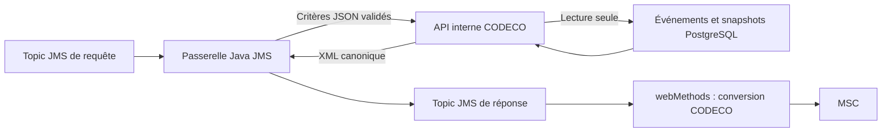

# CODECO MSC / webMethods — préparation locale

Le connecteur répond aux requêtes **JMS asynchrones** de webMethods. Il produit le XML canonique fourni ; **webMethods assure ensuite la conversion CODECO et l’envoi à MSC**. La préparation reste sur la branche locale de migration, sans publication sur le dépôt public.

## Règles confirmées le 12/11/2026

| Élément | Correspondance |
| --- | --- |
| Destinataire | `MSCMAR`, conteneurs de l’armateur `MSC` |
| Entrée d’un conteneur | événement ENTREE, camion entré chargé → Gate In / EXPORT |
| Sortie d’un conteneur | événement SORTIE, camion entré vide puis chargé → Gate Out / IMPORT |
| État du conteneur | EMPTY, activité du port sec |
| Booking MSC | référence EDO/ERO archivée sur le mouvement |
| Code de port | `ZDP`, conservé exactement comme demandé ; distinct du terminalId |
| Poids brut, tare, VGM | champs vides tant que les valeurs ne sont pas disponibles |
| Terminal | `terminalId` encore à attribuer ; aucun remplacement automatique par TC3 ou ZDP |

Les statuts Gate In / EXPORT et Gate Out / IMPORT suivent les deux exemples fournis. Le code reprend leurs noms exacts : `TRANSPORT_ EQUIPEMENT_GATE_IN_REPORT`, `TRANSPORT_ EQUIPEMENT_GATE_OUT_REPORT`, `carrierlName`, les groupes Parties et le bloc transport extérieur vide. Les paramètres de MessageGeneration restent identiques à la requête, avec les deux URI schema/documentType imposées.

## Flux



La passerelle Java utilise les bibliothèques JMS officielles Universal Messaging et son parseur XML standard, avec DTD/entités externes désactivées. L’API Node réutilise `pg` déjà présent dans le dépôt et les bibliothèques standard ; aucune dépendance XML supplémentaire n’est nécessaire. Le poste local impose des scripts PowerShell signés et le registre npm a renvoyé une erreur 503 sur une dépendance XML ; aucune règle de signature/TLS n’a été désactivée et cette dépendance n’est pas utilisée.

## État de validation

- Tests Node exécutés : critères, horaires/DST, sélection MSC, deux conteneurs, mouvements réels, bornes, doublons, booking explicite, ZDP, poids en attente, rejeu, cache persistant et authentification HTTP.
- Le script SQL PostgreSQL a été exécuté dans **PGlite en mémoire avec des données fictives**, y compris les refus de lecture directe et le retrait du CIN/nom d’agent dans la projection.
- Deux XML synthétiques de 4 puis 3 mouvements ont été comparés aux deux XML reçus avec le parseur XML natif d’Edge : structure et constantes identiques. Ce contrôle ne remplace pas une validation par le XSD webMethods.
- La passerelle Java et ses tests XML sont préparés mais **non compilés/exécutés ici** : JDK et JAR Universal Messaging non disponibles. Aucun appel au broker de production, aucune publication JMS, aucun changement de schéma Supabase effectué.

## Préparation IT

1. Fournir un JDK compatible avec la version Universal Messaging installée. Le source utilise les API Java 11 ; faire valider la version exacte par l’équipe webMethods.
2. Placer les JAR de cette installation dans `java/lib/` : `gf.javax.jms.jar`, `nClient.jar`, `nJMS.jar`. Ces fichiers sont ignorés par Git. Ne pas remplacer le client par une bibliothèque IBM MQ, AMQP ou un JAR tiers.
3. Fournir un broker/topic de recette, la ConnectionFactory JNDI, les éventuels alias JNDI des deux topics, un clientId JMS et un nom de souscription durables stables, ainsi que le compte technique et ses droits. Les noms de topics du mail servent de valeurs par défaut pour les recherches JNDI ; faire confirmer les alias si différents.
4. Faire attribuer `terminalId` et confirmer les fuseaux des critères reçus et de `EFFECTIVE_DATE`. Les dates/heures sans fuseau ne sont jamais interprétées avec le fuseau du poste. Les heures ambiguës ou inexistantes lors d’un changement d’heure sont refusées.
5. Confirmer auprès de webMethods le XSD, l’acceptation de `ZDP`, des poids vides et d’une réponse sans mouvement, les bornes `[début, fin)`, les attentes JMSCorrelationID, la taille maximale des messages, la persistance/transaction de la ConnectionFactory et la politique de reprise/DLQ.
6. Sur une base de recette, faire appliquer `sql/postgres_setup.sql` par le DBA. Il crée une table privée d’enrichissement facultatif des poids et une projection limitée `private.codeco_extract`. Le rôle NOLOGIN `codeco_reader` ne reçoit que l’exécution de cette fonction. Un LOGIN technique distinct devra hériter de ce rôle, avec TLS vérifié ; aucun mot de passe n’est créé par le script.

Adresse de production communiquée : `nsp://172.17.18.122:9000`. La recette doit utiliser l’adresse fournie par IT ; aucun démarrage de production n’est inclus dans cette préparation.

Topics attendus :

- Requête : `logistic/outgoingMessagesRequest/xmlOutgoingMessagesRequestTopic`
- Réponse : `logistic/containerDepartureConfirmationMessage/xmlContainerDepartureConfirmationMessageTopic`

## Configuration et lancement après recette

Copier `config.example.json` vers `config.local.json` (ignoré) et renseigner terminalId et les deux fuseaux. Le terminal des groupes Destinations hérite du terminalId tant qu’aucun terminalCode spécifique n’est fourni. Les ports Gate In et Gate Out reprennent ZDP ; le second groupe Gate Out suit la structure du modèle fourni.

Variables API à définir dans la configuration protégée du service Windows :

| Variable | Usage |
| --- | --- |
| `CODECO_CONFIG_FILE` | chemin du JSON privé, sinon config.local.json |
| `CODECO_PG_CONNECTION` | connexion du LOGIN technique à ZENATA, sans option sslmode dans l’URL |
| `CODECO_PG_CA_FILE` | éventuel certificat CA approuvé, TLS toujours vérifié |
| `CODECO_API_TOKEN` | secret aléatoire d’au moins 32 caractères, partagé seulement avec la passerelle |
| `CODECO_STATE_DIR` | cache sur disque local privé, hors des racines IIS/Netlify ; sinon .state/ |
| `CODECO_API_PORT` | 8794 par défaut, écoute 127.0.0.1 uniquement |

Après `npm ci` à la racine du dépôt :

```text
node integrations/codeco/server.cjs
```

Contrat interne : `POST /internal/codeco/responses`, en-têtes Authorization Bearer et Content-Type application/json. Le corps JSON contient les douze valeurs texte de OutgoingMessageRequest. La passerelle seule transforme le XML JMS en ce JSON. Réponse 200 XML, 204 pour une requête destinée à un autre client/terminal/type, 422 pour une donnée métier incomplète et 503 pour un échec temporaire. Aucun endpoint public ou bouton de guichet n’est ajouté.

Variables passerelle : `CODECO_API_URL`, `CODECO_API_TOKEN`, `JMS_PROVIDER_URL`, `JMS_CONNECTION_FACTORY`, `JMS_CLIENT_ID`, `JMS_SUBSCRIPTION_NAME`, et si requis `JMS_USERNAME`/`JMS_PASSWORD`. `JMS_REQUEST_TOPIC_JNDI` et `JMS_RESPONSE_TOPIC_JNDI` permettent les alias validés par IT. L’URL API accepte HTTP sur loopback ; une API distante exige HTTPS et un certificat approuvé. Les secrets ne doivent figurer ni dans les arguments Java ni dans les XML.

Avec le JDK/JAR fournis par IT, depuis `integrations/codeco/` :

```text
javac -cp "java/lib/*" -d java/build java/RequestParser.java java/RequestParserChecks.java java/CodecoGateway.java
java -cp "java/build;java/lib/*" RequestParserChecks ../../CODECO_requete_MSCMAR_TC3_20260711-2308_20260712-0008.xml ../../CODECO_reponse_MSCMAR_TC3_20260711-2308_20260712-0008.xml
java -cp "java/build;java/lib/*" CodecoGateway
```

La souscription durable reste attachée au même JMS clientId/nom après redémarrage. Une session JMS transactionnelle unique porte réception et émission persistante. La réponse reprend JMSCorrelationID si présent, sinon JMSMessageID de la requête ; valider cette convention en recette. Sur erreur, rollback et arrêt visible du service : aucune requête n’est acquittée silencieusement et aucun XML partiel n’est publié. Configurer avec IT la reprise Windows, les alertes et la DLQ avant production.

Avant publication, la passerelle contrôle aussi le type du XML de réponse et la reprise des paramètres de la requête dans chaque confirmation, afin de refuser une réponse qui appartiendrait à un autre terminal ou une autre fenêtre.

## Sélection, historique et rejeu

- La source lit `visit_events.occurred_at` et les snapshots `generated_documents` du même événement, sans reconstruire le passé à partir de la visite courante. Les conteneurs déposés ne sont pas présentés comme sortants lorsque leur camion quitte le site vide.
- Un conteneur par slot d’événement : une visite avec deux conteneurs MSC produit deux confirmations. Un conteneur d’un autre armateur dans une visite mixte est exclu. Les passages distincts du même conteneur sont conservés.
- Fenêtre `[début, fin)` de 31 jours maximum. Les doublons d’un même snapshot d’événement sont regroupés ; des snapshots contradictoires arrêtent le traitement. Les requêtes portant sur des fenêtres qui se chevauchent reçoivent chacune leur réponse, comme attendu pour une extraction périodique ; la déduplication finale entre fenêtres relève du contrat webMethods.
- Le premier XML terminé est enregistré par empreinte des paramètres, puis réutilisé à l’identique en cas de reprise. Une modification de configuration sur une requête déjà cachée est signalée plutôt que d’en changer silencieusement le contenu.
- Le cache contient des XML métier. Restreindre les ACL NTFS au compte de service et aux administrateurs autorisés, l’inclure dans les sauvegardes et convenir de sa rétention. Utiliser un disque local, pas un partage réseau sans prise en charge vérifiée des liens atomiques. Les journaux exposent seulement clé de requête, compte et code d’erreur.
- Le statut enregistré par l’API est « réponse préparée ». Le commit JMS confirme l’acceptation par le broker ; l’acheminement et l’accusé MSC restent suivis dans webMethods.
- Les annulations/corrections après un envoi nécessitent un contrat séparé : le mail ne décrit que `ORIGINAL`. Aucun message d’annulation ou COARRI n’est inventé.

La future migration SQL Server devra aussi transférer l’enrichissement CODECO éventuel et le cache, et porter la projection vers les tables SQL Server. Le manifest initial des 22 tables, établi avant cette intégration, ne les comprend pas. Le transport JMS et le contrat XML pourront rester identiques ; l’adaptateur source PostgreSQL devra être remplacé après validation du portage.

## Tests et aperçu sans envoi

```text
npm run test:codeco
node integrations/codeco/dry-run.cjs config.json request.json movements.json .qa/new-codeco-preview.xml
```

Le dry-run lit uniquement des fichiers JSON locaux et refuse d’écrire hors de .qa ; il ne se connecte ni à la base ni à JMS. Les exemples reçus sont laissés à leur emplacement local et ignorés par Git. Les tests utilisent des conteneurs, identifiants et bookings synthétiques.

Références officielles : [JAR Universal Messaging](https://www.ibm.com/docs/en/webmethods-integration/wm-universal-messaging/12.1.0?topic=jms-required-jar-files-developing-client-applications), [outils JMS et ConnectionFactory](https://www.ibm.com/docs/en/webmethods-integration/wm-universal-messaging/10.15.0?topic=tools-syntax-jms), [guide développeur JMS/JNDI](https://documentation.softwareag.com/universal_messaging/num10-11/10-11_Universal_Messaging_Developer_Guide.pdf). Utiliser les documents correspondant à la version installée pour la recette.
